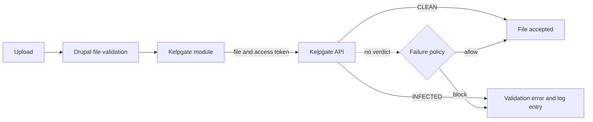

# Kelpgate Malware Scanner for Drupal

[](LICENSE)

Drupal module that scans uploaded files with the [Kelpgate](https://kelpgate.cloud) malware-scanning API during file validation. Infected files fail validation and are not saved; detections are written to the `kelpgate` log channel with the file's SHA-256. Files are streamed to the API rather than loaded into memory.

The module is open source under GPL-2.0-or-later. The Kelpgate scanning service is a commercial hosted product; using it requires a Kelpgate account.

> **Drupal 11.** The module validates uploads through `hook_file_validate()`. Drupal 10.2 deprecated that hook and Drupal 11 no longer invokes it, so on Drupal 11 the module installs but does not scan uploads. Do not rely on it for Drupal 11 sites until support for file validation events is released.

## Contents

- [Requirements](#requirements)
- [Installation](#installation)
- [Configuration](#configuration)
- [Secrets](#secrets)
- [Operation](#operation)
- [Failure policy](#failure-policy)
- [Security and privacy](#security-and-privacy)
- [Verification](#verification)
- [Troubleshooting](#troubleshooting)
- [Compatibility](#compatibility)
- [Versioning and support](#versioning-and-support)
- [Licence](#licence)

## Requirements

| Component | Version |
|---|---|
| Drupal | 9.5 or 10.x (see [Compatibility](#compatibility)) |
| PHP | 7.4 or later, as supported by the Drupal version |
| Kelpgate | API client (client ID and secret) from the [Kelpgate Console](https://console.kelpgate.cloud) |

## Installation

The module is distributed from this repository; Packagist publication is pending.

With Composer:

```bash
composer config repositories.kelpgate vcs https://github.com/KelpGate/kelpgate-drupal
composer require kelpgate/kelpgate-drupal:dev-main
drush en kelpgate
```

Without Composer, place the repository in `modules/contrib/kelpgate` and enable the module under **Extend**.

Configure it at `/admin/config/security/kelpgate`. The settings form requires the `administer kelpgate` permission.

## Configuration

Settings are stored in the `kelpgate.settings` configuration object.

| Key | Environment variable | Default | Description |
|---|---|---|---|
| `enabled` | | `true` | Enable scanning |
| `api_url` | `KELPGATE_API_URL` | | Kelpgate API base URL; HTTPS required except for `localhost` |
| `token_url` | `KELPGATE_TOKEN_URL` | | OAuth 2.0 token endpoint; HTTPS required |
| `auth_mode` | `KELPGATE_AUTH_MODE` | `oauth2` | `oauth2` (client credentials) or `token` (static token) |
| `client_id` | `KELPGATE_CLIENT_ID` | | OAuth 2.0 client ID |
| `fail_action` | `KELPGATE_FAIL_ACTION` | `block` | `block` or `allow`; see [Failure policy](#failure-policy) |
| `max_mb` | `KELPGATE_MAX_MB` | `50` | Largest file scanned, in MB |
| `timeout_seconds` | `KELPGATE_TIMEOUT_SECONDS` | `45` | Timeout for scanner requests |

An environment variable overrides the stored value. Values can also be pinned per environment in `settings.php`:

```php
$config['kelpgate.settings']['api_url']   = 'https://api.kelpgate.cloud';
$config['kelpgate.settings']['token_url'] = 'https://auth.kelpgate.cloud/oauth2/token';
$config['kelpgate.settings']['client_id'] = getenv('KELPGATE_CLIENT_ID');
```

## Secrets

Secrets are never stored in exported configuration. The client secret is resolved in this order:

1. `KELPGATE_CLIENT_SECRET` environment variable.
2. `$settings['kelpgate_client_secret']` in `settings.php`.
3. Drupal state, written by the settings form.
4. Legacy configuration from earlier versions, migrated to state on the next save.

For `auth_mode: token`, the static token is resolved in the same order from `KELPGATE_TOKEN`, `$settings['kelpgate_api_token']`, state and legacy configuration.

```php
$settings['kelpgate_client_secret'] = getenv('KELPGATE_CLIENT_SECRET');
```

## Operation



The module obtains an OAuth 2.0 access token, caches it and renews it before expiry, then streams the file to the scanning API over HTTPS. Validation covers file fields, Media Library and editor image uploads. Only an infected verdict rejects a file on its own; the failure policy governs uploads for which no verdict is available.

## Failure policy

| Condition | `block` (default) | `allow` |
|---|---|---|
| Scanner unreachable or returns an error | Rejected | Accepted |
| Authentication failure | Rejected | Accepted |
| File larger than `max_mb` | Rejected | Accepted |

Use `block` where preventing malware takes priority over availability, and `allow` where uploads must continue during a service outage.

## Security and privacy

| Aspect | Behaviour |
|---|---|
| Data sent | The file content and name, over HTTPS, to the configured API URL only |
| Access control | The settings form requires the `administer kelpgate` permission |
| Secrets | Excluded from exported configuration; see [Secrets](#secrets) |
| User-facing errors | A generic message with a short detection name or error code; full details, including the SHA-256, are logged |
| Service retention | Clean files are retained briefly and infected files quarantined by the Kelpgate service, according to the plan |

Report vulnerabilities privately through the repository's security advisories (**Security > Report a vulnerability**) or according to the [security policy](https://github.com/KelpGate/.github/blob/main/SECURITY.md).

## Verification

Upload a file containing the EICAR test string through any file or media field:

```
X5O!P%@AP[4\PZX54(P^)7CC)7}$EICAR-STANDARD-ANTIVIRUS-TEST-FILE!$H+H*
```

The upload is rejected and an entry appears under **Reports > Recent log messages** in the `kelpgate` channel. Perform this check after every Drupal core upgrade.

## Troubleshooting

| Symptom | Cause |
|---|---|
| Every upload is rejected | The scanner is unreachable or the credentials are invalid while `fail_action` is `block`. Check the `kelpgate` log entries. |
| No upload is ever blocked | Scanning is disabled, the module is not configured, `fail_action` is `allow` during an outage, or the site runs Drupal 11. |
| Authentication errors after changing the secret | Clear caches to discard the cached token, and confirm which source holds the secret. |
| Log reports that the API URL must use HTTPS | The API or token URL is not HTTPS. |

## Compatibility

| Drupal | PHP | Status |
|---|---|---|
| 9.5 | 8.0, 8.1 | Verified: clean file accepted, EICAR rejected, both failure policies |
| 10.1 | 8.1 | Verified |
| 10.3 | 8.2 | Verified; `hook_file_validate()` is deprecated from 10.2 |
| 10.6 | 8.3 | Verified; `hook_file_validate()` is deprecated from 10.2 |
| 11.x | 8.3, 8.4 | Not supported: Drupal 11 does not invoke `hook_file_validate()` |

Verification used a simulated scanning API. All source files lint on PHP 7.4 through 8.4. Combinations not listed have not been tested.

## Versioning and support

The module follows [Semantic Versioning](https://semver.org) and uses version 1 of the Kelpgate API (`/api/v1`). Fixes, including security fixes, are released for the latest version only. Changes are listed in the [changelog](CHANGELOG.md).

See [getting help](https://github.com/KelpGate/.github/blob/main/SUPPORT.md) or contact support@kelpgate.cloud. Contributions follow the [contributing guide](https://github.com/KelpGate/.github/blob/main/CONTRIBUTING.md).

## Licence

GPL-2.0-or-later. See [LICENSE](LICENSE). The Kelpgate scanning service is subject to its own terms.
